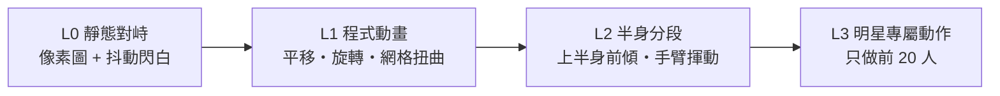

# 🎬 動畫與美術製作方案 (Animation & Art Production)

> 前提：**700+ 位選手，每人只有一張官方去背照**，不可能逐人逐幀製作。方案核心 = **「共用動作 × 每人自動換皮」**，並依難度分 4 個等級，逐級升級，每一級都是可玩的。

---

## 1. 核心難題與策略

| 限制 | 對策 |
|---|---|
| 每人只有 1 張正面照 | 動作不靠「換圖」，靠**程式變形**（位移、旋轉、縮放、網格扭曲）＋**共用特效** |
| 地面需要真實柔術姿勢 | **12 張共用雙人姿勢模板**，每場自動染成兩人的膚色/短褲/刺青 |
| 要看得出是誰 | 臉部與刺青永遠來自官方照；招牌技用**本人大頭特寫切入** |
| AI 額度有限 | AI 只做共用素材（約 100 張），選手本體 0 次 AI |
| 公開 repo | 官方照轉檔的像素圖只在本機/Actions 產生；注意公開 repo 不宜直接提交官方原圖（見 §7） |

---

## 2. 四級路線（每級獨立可玩）

### L0 — 靜態對峙（MVP，第一個能玩的版本）
- 兩人站左右，攻擊 = 衝過去→停頓→彈回
- 效果：閃白、震動、傷害數字、像素火花
- **工作量：極低**，先驗證戰鬥好不好玩

### L1 — 程式動畫 + 網格扭曲（推薦的主力）
SpriteKit 的 `SKWarpGeometry` 可對單張圖做**網格變形**，不用換圖就能做出「出拳前傾、受擊後仰、呼吸起伏」：

| 動作 | 變形方式 |
|---|---|
| 待機 | 胸口網格上下輕微膨脹（呼吸）；體力低時幅度加大、節奏加快 |
| 出拳 | 身體網格朝前扭轉 ＋ 整體平移 ＋ 拳風弧線（共用特效） |
| 踢擊 | 身體後傾 ＋ 下半身網格上抬 ＋ 踢擊弧線 |
| 閃避 | 整體後仰 ＋ 殘影 |
| 受擊 | 頭部區域網格被推向後方 ＋ 閃白 ＋ 擊退 |
| 重擊 KO | 慢動作 ＋ 臉部網格強烈扭曲 ＋ 倒地旋轉 |
| 累積傷害 | 臉部疊瘀青/腫脹/割傷貼圖（共用素材，依傷害程度） |

- **只需一次寫好**，700 人全部適用
- 臉部/胸口位置由「區域模板」決定（官方照構圖一致，位置可固定比例）

### L2 — 半身分段（有餘力時）
- 利用官方照構圖一致的特性，把圖切成：`頭／軀幹／左手臂／右手臂`（用**固定比例切割線**，不用 AI 分割）
- 上半身可獨立旋轉、手臂可揮動，出拳看起來更像真的出拳
- **風險**：切割接縫與背景補洞；先用單人測試，不成功就停在 L1

### L3 — 明星專屬動作（只做前 20 人）
- 招牌動作用 AI 生成**專屬關鍵姿勢圖**（例：Pereira 左鉤拳、McGregor 左直拳）
- 必殺技演出：全螢幕本人大頭特寫 + 速度線 + 招式名

---

## 3. 地面系統美術（沿用 GROUND_GAME_DESIGN）

- 12 張共用雙人姿勢模板（AI 生成後人工挑選，**總共只做一次**）
- 執行時：**膚色染色 + 短褲色 + 刺青疊圖 + 兩人像素頭像貼在頭部位置 or 兩側切入特寫框**
- **先做風險驗證**：挑 1 張姿勢，試「染色 + 換頭」，看接縫是否可接受；不行就改採「姿勢圖染色 + 側邊特寫框」（已在 UI 預覽圖中驗證可行）

---

## 4. 共用素材清單（AI 生成，一次性）

| 類別 | 數量 | 說明 |
|---|---|---|
| 場地背景 | 5 | 八角籠、不同燈光、觀眾 |
| 打擊特效 | 約 20 | 拳風、踢擊弧線、衝擊波、汗水、血滴、火花 |
| 地面姿勢模板 | 12 | 見上 |
| 傷害貼圖 | 約 10 | 瘀青、腫脹、割傷、流血（臉部區域） |
| 卡牌插圖 | 約 40 | 每種招式 1 張（共用） |
| 卡牌框/UI | 約 10 | 稀有度框、按鈕、血條 |
| 裁判/角落/觀眾 | 約 5 | 裁判像素小人、教練 |

**合計約 100 張**，跟選手人數無關。

---

## 5. 演出節奏（10 分鐘一局的感官設計）

| 時機 | 演出 | 時長 |
|---|---|---|
| 賽前 | 雙方入場特寫＋戰績對比＋預測勝率 | 5–8 秒（可跳過） |
| 每次交手 | 翻牌＋平移攻擊＋結算數字（結果章蓋在牌上） | 4–5.5 秒 |
| 重擊/KO 瞬間 | **頓幀 0.08 秒**＋震動＋慢動作 | 1–3 秒 |
| 招牌技 | 本人大頭切入＋招式名 | 2 秒 |
| 回合結束 | 裁判計分卡 | 3 秒 |
| 賽後 | 勝利方式字卡（KO/TKO/SUB/DEC）＋回放精華 | 5 秒 |

可設定「演出速度」：快 / 標準 / 慢（影響一局總時長，10 分鐘為標準）。

---

## 6. 建議落地順序

1. **L0**（和 P2 戰鬥引擎同步）→ 先確認好玩
2. **共用特效素材 20 張** → 立刻提升打擊感
3. **L1 網格扭曲**（做 1–2 個動作原型驗證效果）
4. **地面模板**（先做 3 張驗證染色換頭）
5. L2/L3 視時間與效果決定

## 7. ⚠️ 重要注意（公開 repo）
- 選手官方照屬於 UFC 版權；你是自用，但**公開 repo 會讓照片公開可見**
- 建議：**repo 只放程式與腳本**，轉檔後的像素圖由 Actions 產生並放在 **Release / 私人儲存** 或者每次在本機產生，不要 commit 進公開 repo
- 這點請你決定（見下方待決事項）
