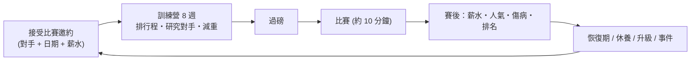

# 🏋️ 生涯養成系統規格 (Career, Gym & Training)

> 養成是長期留存的核心。設計目標：**每一週的選擇都有取捨**（練什麼、休不休息、花多少錢、冒多少險），而且真實 UFC 世界會同步推進。
> 戰力公式請見 [POWER_SYSTEM.md](POWER_SYSTEM.md)，戰鬥規則請見 [STRIKING_AND_DECK.md](STRIKING_AND_DECK.md)、[GROUND_GAME_DESIGN.md](GROUND_GAME_DESIGN.md)。

---

## 1. 生涯主迴圈

- 時間單位：**週**。一場比賽約 12–16 週一輪（8 週營 + 賽前賽後）。
- 玩家主要決策點：接不接邀約、行程怎麼排、花錢在哪、減重多狠、賽前戰術。

---

## 2. 開局：三種起點

| 起點 | 說明 |
|---|---|
| 🌱 **自創新人** | 選背景（摔角／拳擊／泰拳／柔術／全面），決定初始屬性與起始卡牌；從 Contender Series 或區域賽開始 |
| 🆕 **真實新秀** | 選一位剛簽約的真實新人，**帶著真實數據起步**（自動吃到每週更新的新人） |
| 👑 **接手明星** | 接手現役選手（高起點、高期待、高薪水、低成長空間），玩「巔峰管理與衰退」 |

---

## 3. 每週行程系統（Training Schedule）

### 3.1 行動點 AP
- 每週 **10 個行動點**，可分配：

| 行程 | 效果 | 疲勞/風險 |
|---|---|---|
| 🥋 技術課 | 對應屬性 + 對應卡牌熟練度 | 低 |
| 🤼 陪練 Sparring | 實戰經驗大、**可學陪練的招牌卡**、可能受傷 | **高** |
| 🏃 體能 Conditioning | Cardio / 恢復 / 力量 | 中 |
| 🎬 研究對手 Film Study | 解鎖對手傾向資訊 | 低 |
| 😴 休息 / 恢復 | 清疲勞、降傷病風險 | — |
| 📣 媒體/社群 | 人氣、贊助 | 低 |
| 💼 打工 | 早期賺錢（新人窮） | 低 |

### 3.2 疲勞 Load 與傷病風險
- 每項行程累積 **Load**；Load 超過體質上限 → 傷病機率指數上升
- 賽前一週強制進入「減量 Taper」，高強度行程不可選
- **過度訓練 = 一定出事**；這是真實 MMA 的常態，讓玩家必須取捨

### 3.3 成長曲線
- 屬性成長有 **邊際遞減**：<70 成長快，70–85 中等，>85 極慢
- 突破 85 需要**專項教練 + 專項陪練**（見下）
- 每次訓練課可選 **自動結算** 或 **小遊戲**（節奏打靶、摔角讀心）→ 小遊戲表現好 → 成長加成（可關）

---

## 4. 教練團隊 Coaching Team

### 4.1 職位

| 職位 | 影響 |
|---|---|
| 總教練 Head Coach | 賽前戰術效果、角落指示效果、團隊協同 |
| 打擊教練 | 打擊屬性、學打擊卡（拳擊／泰拳／空手道各有專長） |
| 摔角教練 | TD / 防摔 / 籠邊 |
| 柔術教練 | 降伏 / 降伏防守 / 地面轉位 |
| 體能教練 S&C | Cardio / 力量 / 恢復速度 |
| 營養師 | 減重成功率、過磅風險、恢復 |
| 防護員 / 復健師 | 傷病機率與復原速度 |
| 經紀人 Manager | 薪水談判、邀約品質、贊助 |
| 割傷處理 Cutman | 比賽中割傷/腫脹處理（角落時間回復） |

### 4.2 教練屬性
- **專長**（打擊/摔/柔/體能…）、**教學力**（成長速度加成）、**戰術 IQ**（賽前戰術與角落效果）、**激勵力**（影響士氣與疲勞恢復）
- **性格**：嚴厲 / 溫和 / 戰術狂 / 老派 → 與選手性格契合度影響加成（可有衝突事件）
- **薪水與忠誠**：高端教練貴；成績好會被**挖角**；忠誠度低時可能離隊
- **協同 Synergy**：打擊教練＋摔角教練同道館 → 解鎖混合卡（例：摔打結合連段）

### 4.3 教練來源
- 先用 **原型教練**（例：「老派拳擊教頭」「奧運摔角金牌」「巴西柔術黑帶」）＋**真實道館名**
- 真實教練姓名資料不在 ufcstats，需要手動維護；**先不做，之後再補明星教練包**

---

## 5. 道館 Gym

### 5.1 真實道館與特色

| 道館 | 專長（範例，可調整） |
|---|---|
| American Top Team | 全面型、柔術強、陪練多 |
| City Kickboxing | 打擊、速度、技術 |
| AKA | 摔角、體能、壓制 |
| Jackson-Wink | 戰術、全面 |
| Kill Cliff FC | 摔打結合 |
| Tristar | 技術型 |
| Dagestan 系（Eagles/Ahmat 等） | 摔角、壓制、體能 |

> 資料來源：UFC.com 選手頁含「Fighting out of / gym」欄位，可自動歸屬真實陪練陣容。

### 5.2 道館加成
- **設施等級**：影響訓練效率與恢復
- **陪練池**：同道館的**真實選手**可當陪練（可學招牌卡 / 提升對應風格經驗）
- **文化**：高壓型（成長快、傷病多）／平衡型／技術型（慢但穩）
- **轉會**：可換道館，但有**適應期**（屬性暫降、協同重算）

---

## 6. 陪練系統 Sparring Partners

- 選擇陪練對象（來自當前道館的真實選手或原型）
- **強度滑桿**：輕（低風險、低收益）／中／重（高收益、高傷病）
- 結果：
  - 屬性經驗（尤其是陪練的強項）
  - **學習招牌卡進度**（積累到 100% 學會，需多次陪練）
  - 觀察資料（對手相同風格 → 賽前研究加成）
  - 受傷機率（受陪練 **風格強度** 與你的 Load 影響）

---

## 7. 研究與訓練營（Fight Camp, 8 週）

| 週 | 重點 |
|---|---|
| 第 1–2 週 | 規劃：選對手後鎖定訓練營目標（針對性訓練） |
| 第 3–6 週 | 專項強化：針對對手弱點練「克制卡」、陪練模擬對手風格 |
| 第 7 週 | 減量與減重高峰 |
| 第 8 週 | 過磅、補水、賽前戰術確定 |

- **對手研究度 0–100%**：決定戰鬥中看到對手傾向的資訊量
- **針對訓練**：例：對手是摔角壓制 → 練防摔與起身卡 → 帶入戰鬥的牌組選項

---

## 8. 減重與過磅（Weight Cut）

| 玩家決策 | 影響 |
|---|---|
| 選擇量級 | 可升降級 |
| 減重強度滑桿 | 減得越多：體力上限↓、下巴↓、恢復↓ |
| 營養師／補水策略 | 降低副作用，補水成功率 |
| 過磅結果 | 成功 / 驚險 / **失敗**（罰款、對手優勢、比賽取消風險） |
| 賽前補水 | 24–36 小時補水量決定開局屬性回復 |

> 這是真實 UFC 的重要變數，也是**策略深度**：極限減重 → 體型優勢 vs 體力代價。

---

## 9. 傷病與恢復

| 類型 | 影響 | 恢復 |
|---|---|---|
| 手 / 腕 | 重拳卡命中↓ | 4–10 週 |
| 膝 / 腳 | 移動與踢擊↓、防摔↓ | 6–16 週 |
| 肋骨 / 身體 | 體力恢復↓ | 4–8 週 |
| 臉部割傷 / 腦震盪 | 下巴暫降；腦震盪需休養期（**強行出賽會永久傷害下巴**） | 4–12 週 |
| 重大（十字韌帶等） | 可能影響屬性永久小幅 | 24+ 週，可手術 |

- 防護員等級影響復原時間
- **贏比賽也可能受傷**，傷病管理是生涯長線重要決策
- 傷病期間可：做復健、研究影像、專注上半身訓練（降低進度損失）

---

## 10. 經濟系統

### 收入
- 出場費（Show）＋勝利獎金（Win）＋表現獎（FOTN/POTN）
- PPV 分紅（人氣高 + 主賽）
- 贊助（人氣/社群/勝場）

### 支出
- 教練薪水、道館月費、陪練費、營養與醫療、減重花費
- 經紀人抽成

### 投資
- 升級道館設施、聘請明星教練、買斷合約等

> 數字先用簡化模型；之後以真實薪資範圍做校準。

---

## 11. 人氣 Hype 與比賽邀約

- 人氣來源：KO/降伏、精彩比賽、勝場、**賽後採訪選擇**（謙虛／嗆聲／搞笑）
- 影響：邀約品質、薪水、贊助、主賽機會、頭銜戰資格
- **對手選擇**：經紀人每次提供 3 場邀約（難度／薪水／風險不同）；可拒絕，但拒絕太多會降價值
- **短時間邀約**（臨時替補）：高風險高回報，且訓練營只有 2–3 週

---

## 12. 排名與真實世界同步

- **你的選手被插入真實排名**，對手由當週真實排名選出
- **世界模式**（可選）：
  - **Live World**：真實比賽結果每週同步，真實選手傷病/排名同步 → 你面對的是「這週的真實世界」
  - **Snapshot World**：開檔時凍結一份名單，之後自行推演（不被真實更新打斷）
- 每週更新帶來的新秀：自動加入選手池，可被你邀約對戰或簽約為隊友/陪練

---

## 13. 事件系統（劇情與取捨）

隨機事件（每個訓練營 1–2 次），每個事件有 2–3 個選項，各有成本與回報：
- 對手賽前嗆聲 → 回嗆（人氣↑ 氣勢↑，但心態激動）/ 無視
- 教練爭執 → 站教練（協同↑）/ 站自己（士氣↑）
- 贊助商邀約 → 簽（錢↑ 但被限制曝光）/ 拒
- 隊友/陪練受傷 → 去探望（士氣↑、損失訓練）/ 繼續
- 家庭 / 個人事件 → 小幅影響士氣與狀態
- 合約爭議 → 談判小遊戲

---

## 14. 老化、退役與傳承

- 各屬性各有衰退曲線（見 POWER_SYSTEM），**下巴與傷病是否累積**影響壽命
- **退役選擇**：自行決定或被迫
- **名人堂 Hall of Fame**：評分（勝場、頭銜、衛冕、人氣、特殊紀錄）
- **傳承模式 Legacy**：退役後可轉為 **教練/道館主**，培養下一代（接續以新自創選手）
  - 你過去的招牌卡可以成為**傳授技**，傳給弟子
  - 形成長期王朝感

---

## 15. 開局到終局的里程碑（節奏範例）

| 階段 | 目標 | 大約場數 |
|---|---|---|
| 新人 | 通過 Contender Series，簽約 UFC | 3–5 |
| 上升 | 進入排名 Top 15 | 5–8 |
| 挑戰者 | Top 5，頭銜戰資格 | 3–5 |
| 冠軍 | 贏得腰帶 → 衛冕 | 3–10 |
| 傳奇 | 雙冠、名人堂 | 長期 |

---

## 16. 養成系統的實作順序（建議）

1. **最小版本**：每週行程 + 屬性成長 + 簡易賽事邀約 + 傷病（無教練/無經濟）
2. 加入 **教練團與道館**
3. 加入 **減重與訓練營針對性研究**
4. 加入 **經濟與人氣**
5. 加入 **事件系統**
6. 加入 **Live World 同步**
7. 最後 **傳承模式**
