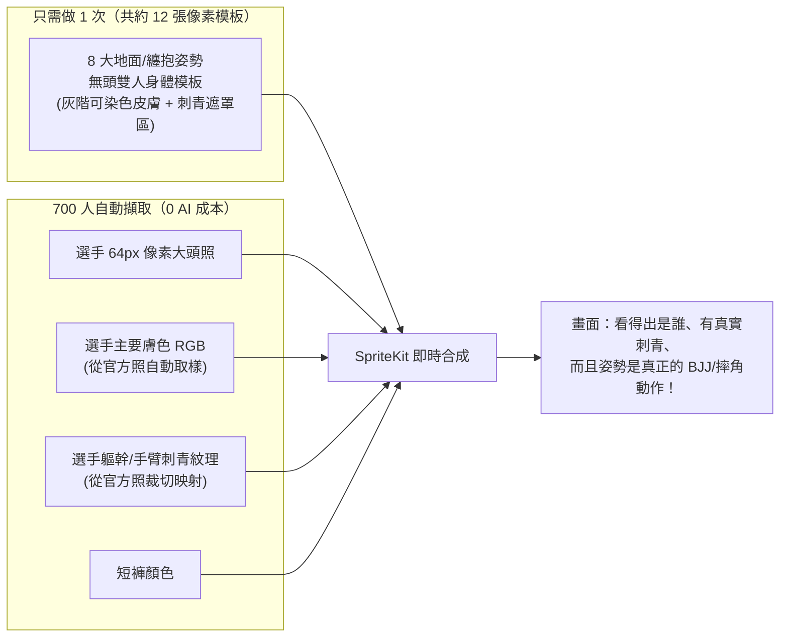
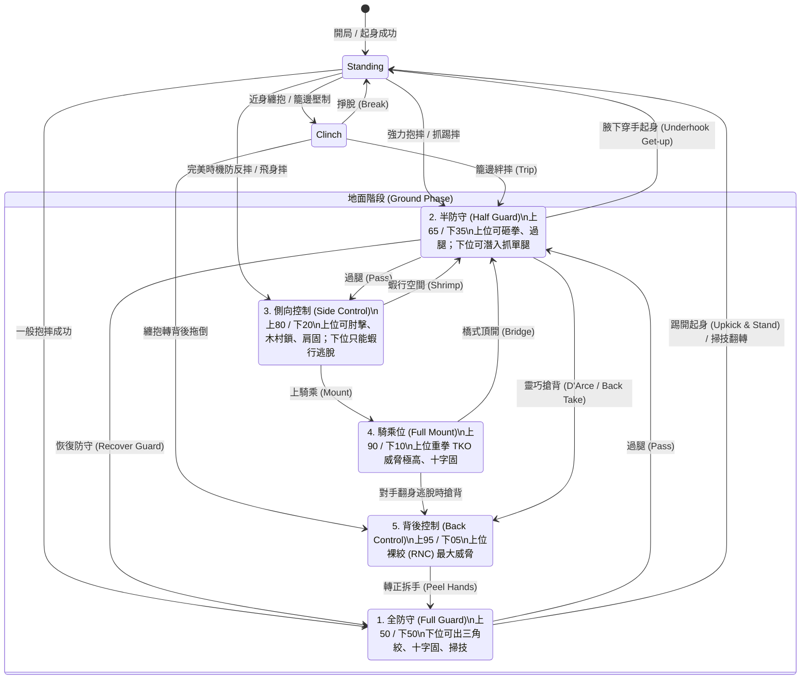
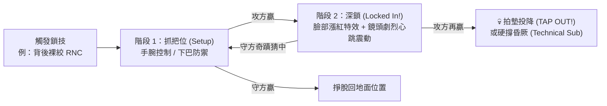

# 🥋 地面戰與纏鬥系統深度企劃 (Ground Game & Grappling Design)

> 在真實 UFC 中，地面戰不是「摔倒就結束」，而是**位置控制（Positional Hierarchy）、體力消耗、地面砸拳（GnP）、轉位（Transition）與降伏陷阱（Submission Chains）**的心理戰。本文件專門設計「既有真實 MMA 深度，又不會讓 700 人美術工作量爆炸」的地面系統。

---

## 1. 為什麼不能只把立繪轉 90 度？怎麼解決地面動作問題？

如果只是把兩張站立照轉 90 度疊在一起，看起來會像兩塊木板撞在一起，沒有「騎乘、鎖技、防守」的感覺。
但如果幫 700 位選手每個人畫地面動作，工作量又不可能完成。

### 解法：「雙層合成法（通用地面身體模板 ＋ 真實選手頭像/膚色/刺青）」

### 具體怎麼運作：
1. **站立時**：直接用選手原本的 128px 官方去背像素半身像（因為站立時每個人架勢、體型、刺青最明顯）。
2. **進入纏抱（Clinch）或地面（Ground）時**：
   - 鏡頭拉近（切入「地面特寫視角」），切換成 **12 張通用雙人纏鬥像素底圖** 之一（例如：全防守 Full Guard、半防守 Half Guard、側控 Side Control、騎乘Full Mount、背後控制 Back Control、斷頭台 Guillotine、裸絞 RNC、三角絞 Triangle、十字固 Armbar 等）。
   - 底圖的身體是**灰階像素分層（上位身體、下位身體、上位短褲、下位短褲）**，SpriteKit 在執行時直接乘上該選手從官方照取樣出來的**真實膚色與短褲顏色**，並把選手胸口/手臂的像素刺青貼圖疊上去。
   - 最後在雙人身體的脖子錨點（Anchor Point）接上兩位選手各自的 **64px 像素頭像**（還會隨受擊切換咬牙/流血表情）。
3. **好處**：
   - 你只需要用 AI 生成並微調 **12 張雙人地面姿勢底圖**（一次性工作）。
   - 任何兩位選手（包含下週剛簽約的新人）進地面，都能立刻呈現出**正確的柔術/摔角姿勢＋本人的臉＋本人的膚色與刺青**！

---

## 2. 地面位置階層圖（Positional Hierarchy）

地面戰的核心是**「先搶位置，再求終結」**。沒有拿到好位置就硬鎖，成功機率極低而且會白白浪費體力。

> **翻轉（Sweep）機制**：當下位選手在 `Full Guard` 或 `Half Guard` 成功打出「掃技 Sweep」且猜中上位選手的行動時，**上下位直接互換**（原本下位變上位 `Side Control` 或 `Mount`），完美還原柔術高手逆轉的爽感。

---

## 3. 地面戰鬥系統：四大行動讀心矩陣

一旦進入地面，雙方的手牌會**自動翻面切換成「地面牌組（上位卡／下位卡）」**。
每次交手（Exchange），上位（Top）與下位（Bottom）各自暗選一張卡，依以下相剋關係結算：

### 3.1 上位選手（Top）的 4 種意圖
1. **📍 推進位置（Advance / Pass）**：想從全防守 → 半防守 → 側控 → 騎乘/搶背。
2. **🔨 地面砸拳（Ground & Pound, GnP）**：用拳/肘削血、消耗對手體力、爭取 TKO。為了出拳必須撐高身體，**會露出空隙**。
3. **🔒 降伏攻擊（Submission Attempt）**：發動斷頭台、肩固、木村鎖、十字固、裸絞。
4. **🪨 重心壓制（Posture / Smother / Ride）**：像 Khabib / Islam 那樣死死壓住對手、封印對手起身、吸乾對手體力並回復自己少許體力。

### 3.2 下位選手（Bottom）的 4 種意圖
1. **🛡️ 防守過腿 / 鎖住距離（Lockdown / Frame）**：專心擋住對手的轉位或重壓。
2. **🏃 逃脫 / 起身（Escape / Wall Walk）**：蝦行退回更好位置，或扶籠網站起來。
3. **🔄 掃技翻轉 / 下位降伏（Sweep / Bottom Sub）**：抓對手撐高出拳的瞬間，用三角絞、下位十字固或剪刀掃翻轉。
4. **🐢 抱頭防守（Shell Up）**：擋掉地面砸拳的大部分傷害，但容易被對手趁機過腿或搶背。

### 3.3 上下位讀心相剋表（核心精華）

| 上位出 ＼ 下位出 | 🛡️ 防過腿 (Frame) | 🏃 逃脫起身 (Escape) | 🔄 掃技/下位鎖 (Sweep/Sub) | 🐢 抱頭防砸拳 (Shell) |
|---|---|---|---|---|
| **📍 過腿推進 (Advance)** | **平手**：下位成功擋住轉位 | 上位大賺：直接進下一階位置 | 上位小賺：壓掉掃技並削體力 | **上位大賺**：輕鬆過腿進到更優位置 |
| **🔨 地面砸拳 (GnP)** | 上位小賺：中量砸拳傷害 | 上位中賺：邊打邊消耗下位 | **下位大逆轉！** 上位撐高被打中掃技翻轉，或直接掉進三角絞/十字固！ | **平手**：下位擋住大部分傷害 |
| **🔒 上位降伏 (Sub)** | 上位進入降伏小遊戲 | **下位大賺**：趁上位抓鎖失敗直接逃脫起身！ | 雙方比拼柔術數值 (Submission vs Defense) | **上位大賺**：深度鎖入，降伏條大幅領先 |
| **🪨 重壓控制 (Smother)** | 上位小賺：下位體力流失 | **上位完封！** 抓到對手想站起來，重摔回地面並抽乾下位體力（Khabib 式折磨） | 平手：上位重心很低，下位掃不動 | 上位小賺：控制時間累積（裁判計分大加分） |

> 這張表把真實 UFC 地面的心理戰完全做出來了：
> - 遇到 **Khabib / Chimaev** 這種上位怪物，你想硬站起來（🏃 Escape）就會被他的重壓（🪨 Smother）吸乾體力；你必須先假裝抱頭或抓他砸拳（🔨 GnP）的瞬間用掃技（🔄 Sweep）破局。
> - 遇到 **Charles Oliveira** 在下位，上位選手就不敢隨便撐起來砸拳（🔨 GnP），因為一砸拳就可能掉進他的三角絞或十字固（🔄 Bottom Sub）！

---

## 4. 降伏終結系統：「2 階段鎖技對決（Submission Minigame）」

當任一方成功發動降伏卡，不會「一翻牌就直接秒殺」，而是進入緊張的 **2–3 回合「鎖技深淺對決（Submission Chain）」**：

- 畫面中央出現一條 **「窒息 / 關節極限條（Choke / Joint Meter）」**。
- 攻方從 3 張鎖技追擊卡選 1 張（例如：`硬掰下巴 Crank`、`調整角度 Adjust Angle`、`雙腿勾死 Body Triangle`）。
- 守方從 3 張掙脫卡選 1 張（例如：`雙手拉扯手腕 Two-on-One`、`轉向緩解壓力 Turn In`、`爆發硬拔 Explode`）。
- **流汗與回合時間加成（真實細節）**：
  - 第 1 回合身體乾澀，降伏成功率較高；第 3 回合以後雙方滿身是汗（Slippery），關節技較容易滑脫，但選手體力見底時更容易被絞技終結！

---

## 5. 地面視覺與演出細節（不增加美術負擔卻超有感）

| 視覺/音效設計 | 實作方式（SpriteKit） |
|---|---|
| **地面鏡頭切換** | 抱摔成功瞬間，八角籠背景往下平移放大，地板畫布（Canvas）與贊助商 Logo 佔滿畫面，營造俯視近距離壓迫感 |
| **地面砸拳演出** | 上位選手像素圖往上拉高（Posture Up）→ 往下猛砸＋拳風殘影＋鏡頭垂直震動＋地板濺起汗水與血滴粒子 |
| **呼吸與體力視覺** | 下位被壓制時，選手像素圖出現急促起伏與汗珠粒子；體力低於 20% 時畫面邊緣出現暗角（Vignette）與心跳聲 |
| **鎖技深鎖演出** | 進入階段 2（Locked In）時，被鎖選手的 64px 頭像疊上**臉部漲紅/青筋濾鏡**，搭配急促喘氣音效 |
| **籠邊（Fence）互動** | 畫面右側顯示八角籠鐵網，下位選手出「扶籠起身（Wall Walk）」時，像素小人會往鐵網移動、鐵網產生晃動動畫 |
| **裁判介入（Stand Up）** | 若雙方在地面連續 3 次交手都只出防守/消極卡（Stalling），裁判像素小人會切入畫面大喊「Work!」，第 4 次強制分開回到站立！ |
