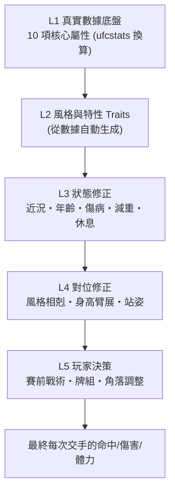
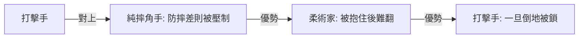

# ⚔️ 戰力系統與進階玩法 (Power System & Advanced Mechanics)

> 目標：讓「OVR 高 = 一定贏」不成立。真實 MMA 的魅力是**風格相剋、狀態起伏、冷門**。戰力由「真實數據底盤」＋「多層修正」組成，玩家則靠**賽前策略、牌組構築、臨場調整**翻盤。

---

## 1. 戰力分層（由底到上）

**OVR 只是顯示用的總評**，戰鬥只讀 L1–L4 的細項，所以 OVR 85 的摔角手打 OVR 90 的純打擊手，可能因對位而勝。

### 1.1 L1：10 項核心屬性（0–100 整數，由 ufcstats 百分位＋貝氏收縮換算）

| 屬性欄位 (`FighterAttributes`) | 中文名稱 | ufcstats / 來源依據 | 主要影響（站立 & 地面） |
|---|---|---|---|
| `power` | 打擊威力 | KD 率、KO/TKO 勝率、量級修正 | 進攻/反擊卡基礎傷害、Rocked 觸發率、Flash KO 率 |
| `speed` | 出手速度 | SLpM（每分鐘有效打擊數）、年齡曲線 | 同時出進攻卡時誰先命中、移動與閃避卡加成 |
| `accuracy` | 打擊精準 | Str. Acc.%（有效打擊命中率） | 進攻/反擊卡命中率修正 |
| `strikingDefense` | 打擊防禦 | Str. Def.%（打擊防禦率）、SApM 反比 | 格擋吸收率、閃避成功率、對手進攻命中減免 |
| `chin` | 抗打下巴 | 生涯被 KD/KO 率反比、SApM 承受度 | 抗 Rocked 檢定、防 Flash KO、頭血上限韌性 |
| `cardio` | 體能心肺 | 3–5 回合比賽佔比、後段回合產出維持率 | 回合間體力恢復量、低體力懲罰門檻 |
| `takedown` | 抱摔能力 | TD Avg.（每 15 分鐘抱摔數）、TD Acc.% | 站立抱摔卡成功率、摔後起始地面位置品質 |
| `takedownDefense` | 防摔能力 | TD Def.%（防摔率） | 防摔（Sprawl）成功率、籠邊轉身脫離率 |
| `submission` | 降伏柔術 | Sub. Avg.、降伏勝率、被降伏率反比 | 上/下位降伏卡成功率、鎖技小遊戲攻防、防降伏 |
| `clinch` | 纏抱與壓制 | 控制時間比（Ctrl%）、籠邊/地面壓制數據 | 籠邊壓制、纏抱髒拳/膝肘加成、地面重壓（Smother）與防起身 |

### 1.2 真實賽事動態升降系統（Opponent-Quality Elo & Live Buff/Nerf）

如果只看生涯平均數據（如 `SLpM`、`TD Avg.`），會出現兩個失真：**「刷弱旅的人數據超漂亮」**、以及**「曾經很強但近期連敗的老將數值還停在巔峰」**。
因此每週自動爬蟲（`rating_calculator.py`）會抓取每位選手的 **完整歷史對戰紀錄（對手是誰、勝負、終結方式、單場統計）**，依時間順序重播計算動態升降：

1. **對手含金量加權（MMA Elo 對手強度修正）**：
   - 每場真實比賽結算時，依雙方的當下戰力積分計算期望勝率 `E = 1 / (1 + 10^((R_opp - R_my) / 400))`。
   - **打贏強敵（下剋上 / 擊敗頂尖排名前段班）**：獲得大幅正向加成（`K * (1 - E)`，對手越強加越多）！
   - **打贏弱敵（虐菜）**：因為 `1 - E` 很小，只獲得微幅加成，防止刷小怪洗上 95+。
   - **輸給強敵（雖敗猶榮，特別是打滿回合接近的判定）**：僅微幅下修。
   - **輸給弱敵（被爆冷門）**：大幅砍弱（`-K * E`）！
2. **「怎麼贏／怎麼輸」精準加砍對應屬性（Targeted Attribute Delta）**：
   不只要升降總戰力，還要依據**現實比賽的結束方式與單場數據**，自動加強贏家的致勝武器、砍弱輸暴露出的破綻（越近期的比賽權重越高，近 3 場佔 60% 動態權重）：
   - **🥊 現實中以 KO/TKO 獲勝 vs 被 KO/TKO**：
     - **贏家**：`power` ↑↑、`accuracy` ↑（若 KO 了原本高 `chin` 的強敵，額外大加 `power` 並可觸發 `.onePunch` 特性）。
     - **輸家（被 KO 方）**：**`chin`（抗打下巴）與 `strikingDefense` 直接下修**；若近 3 場內多次被 KO，自動拔除 `.ironChin` 或貼上 `.glassChin`（玻璃下巴）。
   - **🕸️ 現實中以降伏（Submission）獲勝 vs 被降伏**：
     - **贏家**：`submission` ↑↑、`clinch` ↑；
     - **輸家（拍墊方）**：**`submission`（防鎖能力）直接砍弱**。
   - **🐻 現實中單場大量抱摔/控制獲勝 vs 被全場壓制**：
     - **贏家**：`takedown` ↑、`clinch` ↑；
     - **輸家（單場被摔多次且控制時間長）**：**`takedownDefense`（防摔）直接砍弱**。
   - **🫁 現實中打滿 3/5 回合且後段輸出輾壓**：
     - **贏家**：`cardio` ↑、`speed` ↑；體能崩盤方：`cardio` 下修。
3. **本週賽事自動戰力更新報告（Live Patch Notes）**：
   - 每週日 GitHub Actions 爬完週六剛打完的真實 UFC 賽事後，自動產出本週能力值異動清單（例：`Ilia Topuria 擊敗強敵 Max Holloway (KO R3)：Power 92 → 96 (+4)；Holloway：Chin 98 → 93 (-5)`），讓遊戲永遠反映當下最真實的 UFC 生態。

---

## 2. L2：特性 Traits（從真實數據自動貼標籤）

由爬蟲統計自動判定，**新人也會自動得到**，不用手動維護 700 人：

| 特性 | 判定依據（範例） | 遊戲效果 |
|---|---|---|
| 🧱 鐵下巴 Iron Chin | 場次多、從未被 KO / 被重擊後仍站立比例高 | KO 門檻 +；但累積傷害衰減也會顯現 |
| 💨 開局型 Fast Starter | 第 1 回合表現遠高於後段 | 第 1 回合全屬性 +，R3 起 − |
| 🫁 鐵肺 Gas Tank | 第 4、5 回合數據不衰退 | 體力消耗 −，5 回合戰加成 |
| 🕸️ 柔術黑帶 | 降伏勝多、Sub Avg 高 | 下位降伏卡解鎖、鎖技深度 + |
| 🐻 壓制怪 Smother | 高 TD、高控制時間 | 地面「重壓」卡加成 |
| 🥊 一擊必殺 One-Punch | KD 比例高 | 重擊卡 KO 機率 ×1.3，命中率略低 |
| 🌀 難以預測 Unorthodox | 高 Str.Def 且出手模式雜 | AI 較難讀牌，對手「讀心」成功率 − |
| 🎯 反擊手 Counter | 低出手量、高命中、高防禦 | 反擊卡傷害 ×2 窗口更長 |
| 🧗 籠邊壓迫 Cage Pinner | 纏抱時間高 | 纏抱位置卡加成 |
| 🩹 玻璃下巴 Glass Chin | 曾多次被 KO | KO 門檻 −（真實呈現弱點） |

每人 2–4 個特性。**招牌技 Signature**：依真實勝利方式生成（例：多次 RNC 勝 → 招牌裸絞；多次高踢 KO → 招牌高踢）。

---

## 3. L3：狀態修正（讓選手「活著」）

| 因素 | 規則 |
|---|---|
| 📈 近況 Form | 最近 3 場結果加權：連勝 +、連敗 −（影響信心 = 氣勢 Momentum 起始值） |
| 🎂 年齡曲線 | 各屬性不同曲線：爆發力/速度 30 歲後降；技術/降伏可到 35+；下巴 33 歲後緩降 |
| 🧠 累積傷害 | 生涯被打的次數累積 → 下巴永久小幅下降（真實數據：被 KO 越多越容易再被 KO） |
| ⏳ 休賽鏽 Ring Rust | 超過 12 個月未出賽 → 第 1 回合準度 − |
| ⚖️ 減重 | 減重幅度越大體力越低；過磅失敗 → 罰款＋對手優勢 |
| 🩹 傷病 | 比賽後隨機傷：手、膝、肋骨；影響對應卡（手傷 → 重拳卡命中 −）直到痊癒 |
| 🏕️ 訓練營品質 | 8 週訓練營的完成度給予賽前 buff |

---

## 4. L4：對位系統 (Matchup)

### 4.1 風格相剋（軟性，±8–15%）

實際三角並非絕對：看雙方的防摔／防降伏數值，相剋只是**加權**。

### 4.2 身體條件
- **臂展差**：長臂展選手在「站立遠距離」卡有命中加成；短臂展者靠近身戰補回來
- **站姿**：左撇子 vs 右撇子 → 前手角度/外側腳位置，影響特定卡（直拳、頭踢）命中
- **身高／量級差**：跨量級夢幻對決會有體重差修正（可選擇關閉）

---

## 5. L5：玩家決策（進階玩法的核心）

### 5.1 賽前戰術 Game Plan（3 個滑桿，總和固定）
`站立 ⟷ 摔角 ⟷ 地面`、`壓迫 ⟷ 反擊`、`保守計點 ⟷ 衝 KO`
- 影響：每回合手牌抽牌權重、體力消耗速度、AI 對你的預判
- 遇到鐵下巴對手 → 滑向「保守計點」；遇到玻璃下巴 → 衝 KO

### 5.2 牌組構築 Deck Building
- **牌組 20 張，點數預算制**：每張卡有 Cost（強卡貴）；選手的屬性決定預算上限 → 避免全塞大招
- **卡牌標籤 Tags**：`拳 / 腿 / 肘 / 膝 / 摔 / 鎖`，湊同標籤觸發**套路加成**（例：3 張腿 → 對手腿傷累積加快）
- **連段 Combo**：特定序列觸發額外效果（刺拳→直拳→低掃 = 「三連」，命中後對手防守 −）
- **招牌卡**：每人 1–2 張，需氣勢 (Momentum) 滿才能使用
- **套牌預設**：每位選手出廠自動生成符合其風格的預設牌組，進階玩家可手動改

### 5.3 資訊戰 Scouting
- 「研究對手」：訓練營期間投入時間 → 戰鬥中看得到對手 **近 5 場出牌傾向**（例：「Chimaev 開局 70% 摔」）
- 研究不足 → 傾向顯示為「???」，增加緊張感
- AI 也會**學習你**：同一場內重複相同套路，AI 預判率上升

### 5.4 臨場調整
- 回合間角落指示（4 選 1）：`穩住呼吸 / 針對腿部 / 改打摔 / 全力搶 KO`
- **裁判計分可見**（可關）：知道自己落後 → 必須冒險；領先 → 保守跑點

---

## 6. 生涯期的戰力成長 (Progression)

| 系統 | 內容 |
|---|---|
| 🏋️ 屬性成長 | 訓練有**邊際遞減**，≥85 後成長極慢；需專項教練才能突破 |
| 🧑‍🏫 教練協同 | 打擊教練 + 摔角教練同屬一個道館 → **協同加成**（例如 Kill Cliff 的摔打結合） |
| 🥋 陪練 | 真實選手當陪練 → 教你**該選手的招牌卡**（訓練完成度高才會學會） |
| 📚 卡牌升級 | 同一張卡使用次數 → 精通等級（命中/傷害微幅 +） |
| 🧬 特性解鎖 | 滿足條件（例：連續 3 場用 TD 勝）→ 解鎖新特性 |
| ⭐ 人氣 Hype | 精彩比賽 + 賽後採訪 → 人氣 ↑ → 解鎖大賽、薪水、挑戰權 |
| 🔥 宿敵 Rivalry | 互相擊敗的對手 → 再戰有額外氣勢與劇情事件 |

---

## 7. 平衡與真實性：「回測引擎」（我認為最重要）

用**真實歷史比賽**驗證戰力公式，而不是憑感覺調：
1. 對過去 N 年的真實對戰，用「賽前當下的數據」跑 10,000 場模擬
2. 比較模擬勝率 vs 真實結果（目標：預測方向正確率 ≥ 真實賠率水準，約 65–70%）
3. 發現系統性偏差（例如摔角手被過度高估）→ 回頭調 L1–L4 的權重
4. **每週更新後自動重跑**，確保新資料不會讓平衡崩壞

附帶好處：「本週賽事」模式可以顯示**遊戲預測勝率**，賽後對照真實結果，玩家可以比誰猜得準。

---

## 8. 難度與模式變體
| 模式 | 差異 |
|---|---|
| 休閒 | 顯示對手傾向、裁判計分，AI 不學習 |
| 標準 | 需研究對手；AI 學習 |
| 硬派 | 傷病永久、下巴衰退真實、無提示 |
| 經典重現 | 還原歷史：例「R3 落後 10 分，必須 KO」之類的情境挑戰 |
